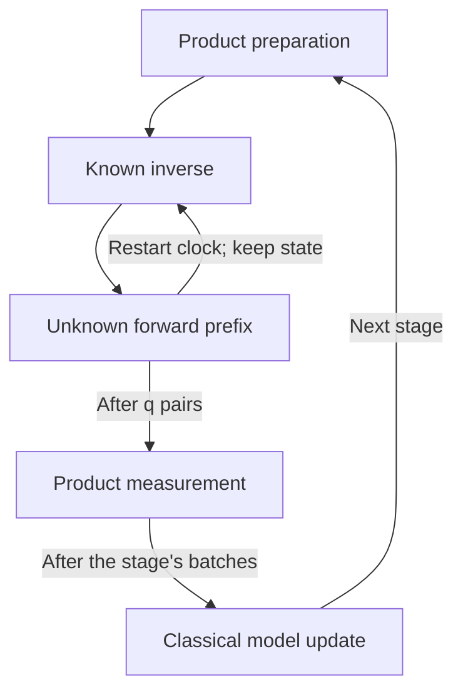

# From Nielsen and Chuang to coherent waveform learning

The experiment begins with a familiar quantum-computing task: apply a pulse to a register and measure its effect. A complete calibration of the final gate can still leave the pulse's intermediate interactions undetermined. The present learning task asks for their strengths as functions of time.

This bridge uses Nielsen and Chuang's *Quantum Computation and Quantum Information*, **10th Anniversary Edition (2010)**, as its single educational anchor. The [publisher's edition page](https://www.cambridge.org/highereducation/books/quantum-computation-and-quantum-information/01E10196D0A682A6AEFFEA52D53BE9AE) and [official contents](https://assets.cambridge.org/97811070/02173/frontmatter/9781107002173_frontmatter.pdf) identify the source. Section references below use that edition. The examples and connections on this page are derived for this project; the complete many-body proofs remain in [science/](../science/model.md#reading-route).

Use this page alongside [the 30 milestones](MILESTONES.md). It supplies a connected entry into the result, while the milestone map records the understanding targets and their dependencies.

## 1. What to bring from the anchor

| Anchor location | Foundation to use | Connection developed here |
|---|---|---|
| §§2.1.3, 2.1.6–2.1.9 | Pauli algebra, tensor products and noncommuting operators | Local interaction coefficients and the sign of an echo response |
| §§2.2.1–2.2.8 and 2.4 | States, evolution, measurement probabilities and mixtures | Product preparations, measured means and unobservable global phase |
| §§3.2.1 and 4.2–4.7 | Circuit operations and resource accounting | The ordered inverse/prefix pair and the cost of implementing a learned model |
| §§8.2 and 8.4.2 | Channels and their experimental characterization | Selected local process-transfer entries instead of a full channel description |
| §§9.2.1–9.2.3 and 9.3 | Operational comparisons between states and processes | The distinction between local coefficient error and implementation error |
| Appendix 1 | Expectations and repeated random observations | Simultaneous confidence bounds for many local estimates |

Section 5.2 is a useful optional comparison: repeated unitary action can increase sensitivity to a phase. The algorithm here implements its own residual-echo experiment; it does not assume controlled access to the unknown unitary or the phase-estimation circuit's input resources.

The book supplies the quantum-information language. Finite-time locality, the paid waveform initializer and high-precision lattice compilation are research-level ingredients identified in [related work](../references/RELATED_WORK.md). The differential inverse and its error analysis are developed in the project's scientific account. The book's elementary simulation discussion alone does not establish the gate bound used here.

## 2. The objects in the learning problem

Write the Hamiltonian, the operator generating time evolution, as

```math
H(t)=\sum_{a\in\mathcal A}h_a(t)P_a.
```

Each known $`P_a`$ is a tensor product of one-qubit Pauli operators and identities. It specifies which qubits interact and along which axes. The unknown real number $`h_a(t)`$ specifies the strength at time $`t`$. Every coefficient is a polynomial of degree at most $`m`$. The interaction pattern has finite range and bounded incidence on a fixed-dimensional lattice.

The proof uses $`\hbar=1`$ and a dimensionless interval $`0\leq t\leq1`$. A physical pulse of duration $`T`$ is converted by $`H(t)=T H_{\rm phys}(Tt)`$. The [model](../science/model.md#1-hamiltonian-family) gives this conversion and the fixed local-strength bound. The horizon is fixed when precision is refined.

| Symbol | Meaning |
|---|---|
| $`U_H(t,s)`$ | Evolution under the unknown drive from time $`s`$ to time $`t`$ |
| $`\widehat H(t)`$ | The current classical polynomial model, used to compile known controls |
| $`R(t)=H(t)-\widehat H(t)`$ | The remaining Hamiltonian error |
| $`\delta`$ | A current bound on the largest coefficient error over all times |
| $`\epsilon`$ | The requested final bound on that same function error |
| $`\rho`$ | The allowed probability that the final guarantee fails |
| $`q`$ | The number of coherent inverse/prefix pairs in one shot |
| $`L_t`$ | An integrated, rotated residual whose coefficients are measured indirectly |

The estimate is successful when every coefficient function is accurate at every time. The target concerns the functions, so the model is stored in a stable Chebyshev basis. It is neither a statement about individual monomial coefficients nor a same-sized error bound for the global quantum channel. An identity term is omitted because its time-dependent global phase is unobservable in the granted experiments. The unadorned $`\rho`$ in the theorem is a failure probability; the subscripted $`\rho_{\rm in}`$ and $`\rho_{\rm out}`$ in the process proof denote density matrices.

## 3. A complete one-qubit example

Consider a qubit with $`H(t)=h(t)Z`$. The Pauli $`Z`$ has eigenvalue $`+1`$ on $`\lvert0\rangle`$ and $`-1`$ on $`\lvert1\rangle`$. Its evolution creates a relative phase between these states. Since the generator always points along the same axis,

```math
U_H(t)=e^{-iZ\theta(t)},\qquad
\theta(t)=\int_0^t h(s)\,ds.
```

Compare two possible waveforms,

```math
h_A(t)=a,\qquad h_B(t)=a+c(2t-1).
```

Their time integrals are $`at`$ and $`at+c(t^2-t)`$. At $`t=1`$ both yield the gate $`e^{-iaZ}`$, for any allowed $`c`$. An experiment confined to the completed pulse cannot distinguish them. At $`t=1/2`$, their accumulated phases differ by $`-c/4`$. Prefix access makes this difference observable.

Suppose the supplied reference is $`\widehat h(t)=a`$, and the true waveform is $`h_B`$. Apply its known inverse first and the unknown prefix second. Matrix products act on a state from right to left, so the implemented pair is

```math
E_t=U_H(t)U_{\widehat H}(t)^\dagger
=e^{-iZ\ell(t)},\qquad
\ell(t)=c(t^2-t).
```

Repeating the pair on the same coherent state gives $`E_t^q=e^{-iqZ\ell(t)}`$. Prepare the $`+1`$ eigenstate of $`X`$,

```math
\lvert+\rangle=
\frac{\lvert0\rangle+\lvert1\rangle}{\sqrt2},
```

and measure $`Y`$ after all $`q`$ pairs. The two outcomes are $`+1`$ and $`-1`$, with probabilities

```math
p_{\pm}(t)=\frac{1\pm\sin(2q\ell(t))}{2}.
```

The mean outcome is consequently $`\sin(2q\ell(t))`$. At the midpoint it is $`-\sin(qc/2)`$. Its sign follows from $`U_H=e^{-iZ\theta}`$ and the stated Pauli conventions. The two echo orders coincide in this commuting example; the many-body algorithm uses the inverse-first order specified above. In the linear-response regime, division of the mean by $`2q`$ estimates $`\ell(t)`$. Differentiating then recovers

```math
h_B(t)-\widehat h(t)=\ell'(t)=c(2t-1).
```

The measurement gives an accumulated residual first. Several prefix times and a controlled derivative step are needed to recover the instantaneous waveform. A single completed-pulse estimate would still miss it.

This example starts from a supplied reference and has commuting dynamics. The full algorithm pays for [coarse initialization](../science/resources.md#paid-initialization), and its [noncommuting example](../science/interpretation.md#identical-final-gates-can-hide-different-noncommuting-waveforms) shows that endpoint ambiguity persists beyond this simple setting.

## 4. Why refinement uses longer coherent shots

A mean of $`N_{\rm shot}`$ independent $`\pm1`$ outcomes has standard deviation at most $`N_{\rm shot}^{-1/2}`$. In the example, division by $`2q`$ makes the corresponding response uncertainty of order $`1/(q\sqrt{N_{\rm shot}})`$ while the response remains in its controlled local regime. Repetition amplifies the phase before measurement; measuring between pairs would produce a different experiment.

Suppose a current model is already accurate to $`\delta`$. The algorithm chooses $`q`$ proportional to $`1/\delta`$, with a sufficiently small proportionality constant. The amplified residual remains in a fixed small range even as $`\delta`$ shrinks. One stage can then improve the model by a constant factor using a number of fresh shots independent of $`\delta`$, apart from the confidence allocation. Its coherent length grows instead.



Each shot starts with a fresh product state. The inner loop preserves that shot's quantum state while restarting the classical pulse schedule. A stage collects fresh shots at its required prefix times before updating the model. The unknown drive must be isolated during the known controls, and intermediate states can be entangled.

In this refinement scheme, $`q`$ is chosen using the current error bound. Simply increasing it can leave the linear regime or produce phase ambiguity. The initializer and the maintained error radius make the successive choices of $`q`$ meaningful. The [contraction proof](../science/reconstruction.md#3-one-refinement-step) fixes the constants, controls the nonlinear bias and includes implementation error.

## 5. How a local measurement survives an extensive residual

For many qubits, small coefficient errors do not mean a small global Hamiltonian. For example, $`R=\delta\sum_{j=1}^n Z_j`$ has operator norm $`n\delta`$. A measurement on the first qubit is nevertheless unaffected by the terms on the other qubits in this example. Its response depends on $`\delta`$, not on $`n\delta`$.

The general argument replaces that exact separation by finite-time locality. Under the known reference evolution, each original local term develops tails whose norm decays with distance. The proof bounds both the interaction strength touching a site and its support-size-weighted version. The latter pays for the overlap in a double commutator. These two bounds give a local response remainder of order $`(q\delta)^2`$, with constants independent of the total system size. See [the local interaction moments and Dyson bound](../science/local_response.md#2-local-interaction-moments).

To read a coefficient of $`L_t`$, choose a Pauli $`P`$ and a one-site Pauli $`Q`$ that anticommutes with it. Let $`B=iPQ`$; this is a Hermitian Pauli with a possible minus sign. The required process-transfer entry is

```math
f_{P,t}(q)
=2^{-n}\mathrm{Tr}\bigl(QE_t^qBE_t^{-q}\bigr)
=2q\,l_P(t)+O((q\delta)^2),
\qquad
l_P(t)=2^{-n}\mathrm{Tr}(PL_t).
```

In the one-qubit example, $`P=Z`$, $`Q=Y`$ and $`B=X`$, recovering the linear term $`+2q\ell(t)`$ in the measured sine. The factor $`2^{-n}`$ normalizes the Pauli coefficient. The signed operator $`B/2^n`$ is a mathematical coefficient probe; it is not a physical density matrix to prepare.

[The product estimator](../science/local_response.md#5-product-state-transfer-estimator) implements this probe through weighted data from physical product states. Random preparation axes, input eigenvalue signs and output axes select the desired entry in expectation. A bounded-weight entry has bounded second moment, so one full-register snapshot can contribute to many local estimates. A union bound produces the logarithmic system-size factor in the number of shots. Preparing, reading and processing each snapshot still takes extensive work.

## 6. The missing step for noncommuting waveforms

When the reference Hamiltonian rotates the residual, the measured integral is

```math
L_t=\int_0^t
U_{\widehat H}(t,s)R(s)
U_{\widehat H}(t,s)^\dagger\,ds.
```

There are two contributions when its endpoint changes: a new residual term enters the integral, and the previously accumulated terms rotate under the reference. Differentiating gives

```math
L_t'=R(t)-i[\widehat H(t),L_t],
\qquad
R(t)=L_t'+i[\widehat H(t),L_t].
```

The commutator correction accounts for that known rotation. In the one-axis example it vanishes, leaving ordinary differentiation. Omitting it for a general pulse would reconstruct the wrong Hamiltonian.

Only a constant number of reference interactions overlap any specified original term. Their commutators require additional response strings of weight at most $`2k-1`$ when the original terms have weight at most $`k`$. Thus the inverse uses a list of $`O(n)`$ local responses, not a reconstruction of the entire operator $`L_t`$. The exact derivation and support count are in [local response](../science/local_response.md#6-the-local-data-required-for-waveform-inversion).

## 7. Why noisy response values determine a whole waveform

Differentiating arbitrary noisy data is unstable. Here the residual coefficients lie in a known degree-$`m`$ polynomial space. Markov's polynomial inequality bounds their derivatives by their uniform size times $`2m^2`$ on $`[0,1]`$. Combined with the response equation and locality, it bounds the relevant response curvature by $`C(1+m^2)\delta`$.

The response functions themselves need not be polynomials. A fixed, sufficiently small finite-difference spacing therefore estimates their derivatives with bias proportional to $`\delta`$. One-sided stencils keep endpoint queries inside the pulse. Dividing the amplified measurements by $`2q`$ also makes their value errors proportional to $`\delta`$. The [reconstruction account](../science/reconstruction.md#2-fixed-times-and-explicit-accuracy-scales) balances these two effects.

The resulting residual estimates at $`m+1`$ Chebyshev nodes determine a polynomial. The interpolation operator enlarges nodal errors by at most a logarithmic degree factor. Because the true residual already belongs to this polynomial space, no extra approximation tail remains. Statistical error, echo nonlinearity, control error, finite differences, interpolation and numerical rounding then fit inside a contraction from $`\delta`$ to $`\delta/2`$.

A finite grid also checks that the known model stays bounded, including on unsuccessful statistical histories. It aborts on excessive values; pointwise clipping would destroy the polynomial assumption. Fresh data at each stage make the confidence bound valid conditional on earlier adaptive choices. These details are necessary for the algorithm's full guarantee, and are proved in [reconstruction](../science/reconstruction.md).

## 8. Assemble the resource statement

Halving the maintained radius makes the coherent repetition counts grow geometrically. Their sum is of the same order as the last count. At fixed horizon, strength, geometry and degree, this produces inverse-precision unknown-evolution cost, with logarithmic confidence and iteration factors. A single unknown static Pauli coefficient already supplies a matching precision-exponent lower bound under coherent access.

| Resource | What must be counted |
|---|---|
| Starting model | A paid independent-prefix waveform learner at the required coarse accuracy |
| Unknown dynamics | Every replayed prefix and its duration |
| Known inverse | Compilation, all executed gates, coefficient data and ancillary workspace |
| Coherence | A longest shot with order $`1/\epsilon`$ repetitions |
| Fresh observations | Every prepared register and all measured local outcomes |
| Classical result | All degree-$`m`$ coefficient polynomials and their numerical precision |
| Implementation accuracy | Shrinking per-pair control/replay error and timing tolerances |

The [resource account](../science/resources.md) makes these statements quantitative. A fixed physical error per pair eventually exceeds the required budget, so the coherent asymptotic theorem does not extend automatically to fixed decoherence or drift. A fixed query-time grid also does not imply fixed timing accuracy.

The scientific gain is a precision law for an extensive waveform output under stronger coherent experimental access. The independent-prefix comparison has weaker access. The [finite-shot calculation](../verification/README.md) supports the response and refinement mechanism with explicit large shot counts; it does not establish a practical crossover. [The final milestones](MILESTONES.md#m30) combine the mechanism, resources, evidence and scope into the complete claim.

[Learning routes](README.md) · [The exact theorem](../science/model.md) · [Project overview](../README.md)
